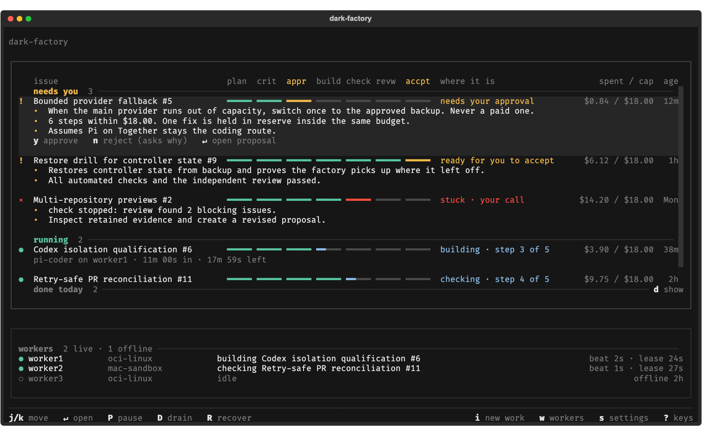

# Dark Factory

Modular framework for building an autonomous software factory with durable coding agents. Provider-agnostic, and adapts to your CI/CD, tracker, and preferred tools. Every acceptance criterion needs evidence and a human decision.

Pick issues from your tracker and approve a plan. Agents then run the work in isolated workspaces: plan, implement, run your checks, and review. The factory keeps the code and the evidence for each acceptance criterion, and you decide what ships.

**Plan → approve → implement → check → review → accept.**

## Built to fit your stack

The controller enforces scheduling, budgets, leases, and approvals. Everything specific to your tools is a replaceable adapter:

- **Coding agents:** Each role (planner, critic, coder, and reviewer) is routed to a harness and model. [Claude Code](docs/claude-subscription.md), [Codex CLI](docs/durable-execution.md), and [Pi](docs/pi-together.md) are supported. With Pi, you can use any provider it supports, such as Together. Routes pin the provider, account, region, and spending limit.
- **Trackers and code hosts:** Work comes in and goes out through small JSON command adapters. GitHub adapters are included; another tracker or code host needs a script that speaks the same commands.
- **Checks and CI/CD:** Acceptance is tied to the canonical commands you already run, such as tests, linters, and builds. Manual gates cover anything else. Results bind to the exact commit, so a passing exit code alone never counts as acceptance.
- **Execution environments:** Workers can run locally or on [remote machines over verified TLS](docs/distributed-execution.md), under native macOS isolation. OCI and VM sandbox drivers plug into the same interface and are qualified separately.
- **Durable runs:** Attempts are leased, budgeted, and checkpointed. An optional [durable workflow runtime](docs/durable-execution.md) checkpoints dispatch. Every workspace is archived and verified before it's removed. A step interrupted by a lost worker, a provider hiccup, or a malformed answer [resumes from its saved work](docs/usage.md#interrupted-steps); anything less trivial waits for you.
- **Decision agents:** An optional decider, such as TypeSafe's Jev, can weigh in on whether an interrupted step should resume. It only advises; code keeps the approved limits.
- **Task supervisor:** Each root has a durable task list, current state and next actions. A low-cost structured-output model can reconcile free text into approved tasks, while code keeps scope, budgets, evidence and execution authority.
- **Prompts and skills:** Packaged defaults can be overridden per project in `factory.toml`.

You drive it from a terminal console (`dark-factory tui`), the focused browser dashboard at `/operator/login`, or a scriptable CLI. The supervisor and worker run as a separate service, so closing a client does not stop work.

Docker is optional. `serve --worker` runs a co-located supervisor and worker on one host. A distributed deployment can put the stateful supervisor in a container and run execution workers on separate Macs, VMs, or container hosts; only worker machines need the selected agent CLIs and inference credentials. See [project-scoped supervisor and workers](docs/distributed-execution.md#what-runs-where).



## Example stack

This is just one example, and it's totally customizable. Each stage is a route or adapter in `factory.toml`, so you can swap any piece for the tools you already use.

| Stage | Example tools | How it connects |
| --- | --- | --- |
| Intake | GitHub Issues and Projects | Tracking adapter lists labeled issues and open issues on your project boards, grouped by project and theme |
| Planning | GPT Astra via Codex CLI | Planner route |
| Critique | Claude Opus via Claude Code | Critic route, on a different model from the planner |
| Approval | You, in the TUI | Recorded human decision with a spending limit |
| Implementation | DeepSeek Flash via Pi, on the Pi Durable runtime | Coder route through a provider Pi supports, such as Together |
| Checks | Your test, lint, and build commands; GitHub Actions | Canonical commands run in the sandbox; CI results on the PR can be required too |
| Interruptions | Jev as the decision agent | Rules resume trivial interruptions; Jev can confirm or hold them for you, within approved limits |
| Review | Devin and Bugbot on the PR, plus the factory's reviewer | Reviewer route, plus required outside reviews read from the PR; they count only on the exact candidate commit |
| Accept and merge | You | Accept in the TUI, then merge under your branch rules |

Routes pin each model's provider, account, and processing region. A route to a region your policy blocks won't run.

## Principles

- **People own intent.** The factory doesn't choose the roadmap. Implementation and acceptance need recorded human decisions.
- **Models judge; code enforces.** Models can't waive checks, expand their budget or permissions, or accept their own work.
- **Evidence has exact inputs.** Checks and reviews are tied to the commit and environment that produced them.

See the [constitution](.specify/memory/constitution.md) for the full set.

## Try it

Requires Python 3.11+.

```bash
git clone https://github.com/yeutterg/dark-factory.git
cd dark-factory
python3 -m venv .venv
source .venv/bin/activate
pip install -e ".[dev]"
cp examples/factory.toml factory.toml
dark-factory --config factory.toml demo
# Keep this supervisor running (or install it as a service):
dark-factory --config factory.toml serve --worker
# In another terminal:
dark-factory --config factory.toml tui --actor you
```

The demo uses simulated agents with real Git workspaces and checks. It makes no model calls and stops for your review.

Or run the separated supervisor, worker fixture, and operator client with Docker Compose:

```bash
./scripts/compose-init
docker compose up --build -d server worker
docker compose run --rm client tui --actor operator
```

This Compose profile is simulation-only and publishes no controller port. See the [Docker Compose installation](docs/docker-compose.md) before substituting a live worker.

Run tests with `python -m pytest -n auto`; lint and type-check with `ruff check src tests` and `mypy`.

## Status

This is early. The control plane, adapters, task dashboard, and isolation are tested with simulated and loopback providers. Live-model and live task-steering qualification are still pending. Multi-repository work and previews come later.

[Usage guide](docs/usage.md) · [Docker Compose](docs/docker-compose.md) · [Live configuration](examples/factory-live.toml) · [Qualification status](specs/qualification.md) · [Roadmap](specs/tasks.md)

MIT licensed.
